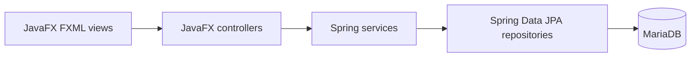

# Smart Grocery List

A university team project (SWT-SWL-B, winter semester 2023/24) for managing a grocery catalogue, a shopping list and purchase history, with suggestions based on purchase intervals and frequently co-purchased items.

**Project status:** archived coursework with reviewed correctness fixes. All 42 backend tests pass; real MariaDB acceptance passes 25 scenarios. The full suite and remaining UI limitations are documented in [verification](doc/VERIFICATION.md). This is a desktop application, with no hosted web demo.

## What the application does

- Manage catalogue items with names, categories, units and images.
- Search and filter items; add catalogue items to a shopping list.
- Record selected shopping-list items as purchases and remove them from the list.
- Import UTF-8, semicolon-separated purchase-history CSV files; skip previously imported identical contents and sort/filter history.
- Suggest replenishment using average purchase intervals.
- Suggest related items using an Apriori-style frequent-itemset implementation.

## Technology

Java 11 source/target, JavaFX 11.0.2, Spring Boot 2.3.0.RELEASE, Spring Data JPA, MariaDB 10.5, Gradle Wrapper 7.6. Tests use JUnit 5, Mockito, H2 and TestFX. Node dependencies provide Java formatting only.

## Architecture



JavaFX and Spring run in the same process. `App.init()` creates the Spring context and gives its bean factory to the FXML loader. Controllers call services directly. Some workflow logic still lives in controllers; entities also contain JavaFX properties.

## Read the code in five minutes

| Question | Start here |
| --- | --- |
| How does the application start? | [Main.java](xtasks/src/main/java/xtasks/Main.java), [App.java](xtasks/src/main/java/xtasks/App.java) |
| How are catalogue items validated? | [ItemsService.java](xtasks/src/main/java/xtasks/backend/services/ItemsService.java) |
| How does a purchase move to history? | [GroceryListViewController.java](xtasks/src/main/java/xtasks/javafx/controller/GroceryListViewController.java), [PastPurchasesService.java](xtasks/src/main/java/xtasks/backend/services/PastPurchasesService.java) |
| How are replenishment suggestions generated? | [SuggestionsService.java](xtasks/src/main/java/xtasks/backend/services/SuggestionsService.java) |
| How are related items found? | [AprioriService.java](xtasks/src/main/java/xtasks/backend/services/AprioriService.java) |
| How are imports validated and deduplicated? | [PurchaseImportService.java](xtasks/src/main/java/xtasks/backend/services/PurchaseImportService.java) |
| Where are tests? | [test sources](xtasks/src/test/java/xtasks) |

## Run locally on Windows

Prerequisites: JDK 11 and a running Docker Desktop with Compose. Git is needed to clone. No separate global Gradle installation is required.

From this repository root in PowerShell:

```powershell
Copy-Item infrastructure/database/.env.example infrastructure/database/.env
docker compose up -d database
docker compose logs database
Set-Location xtasks
.\gradlew.bat --version
.\gradlew.bat bootRun
```

Wait for MariaDB to finish initialization before starting Java. Example credentials match the existing `application.yml` and are for local demonstration only. To override the application credentials, set `SPRING_DATASOURCE_USERNAME`, `SPRING_DATASOURCE_PASSWORD` and, if needed, `SPRING_DATASOURCE_URL` in the application terminal and use matching database settings.

The Gradle JavaFX plugin declares the JavaFX libraries. Try the wrapper first rather than manually adding SDK jars and VM flags in the IDE. See [setup](doc/SETUP.md) for tests and troubleshooting.

## Repository map

```text
README.md                 Project entry point
doc/                      Architecture, setup and limitations
doc/archive/              Original template docs and legacy CI (historical only)
docker-compose.yml        MariaDB service (not a packaged desktop app)
infrastructure/database/  Local database configuration example
xtasks/                   Existing application module; original name retained
  src/main/java/xtasks/    Entry points, controllers, services, entities, repositories
  src/main/resources/     FXML views, images and runtime configuration
  src/test/               Test code and H2 test configuration
```

## Review and attribution

- [Architecture and current behavior](doc/ARCHITECTURE.md)
- [Known limitations](doc/KNOWN_ISSUES.md)
- [Team and personal contribution](doc/CONTRIBUTIONS.md)

This is collaborative coursework, not a claim of sole authorship. The portfolio owner is Kaiyue Han; report-supported responsibilities are documented in [contributions](doc/CONTRIBUTIONS.md), with commit-level authorship still unverified. Existing GPL license files are preserved. The original report is intentionally not bundled in this public-facing candidate because it contains student identifiers and personal declarations; prepare a reviewed public copy separately.

Screenshots and a short demonstration should be added after a successful local run. No screenshots, passing-test badges or coverage claims are fabricated here.
