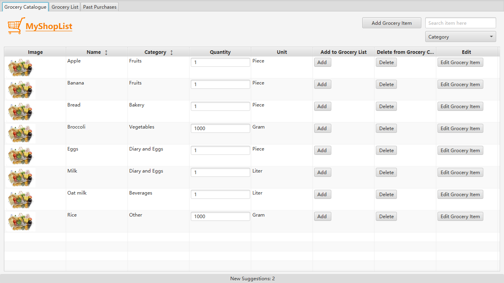
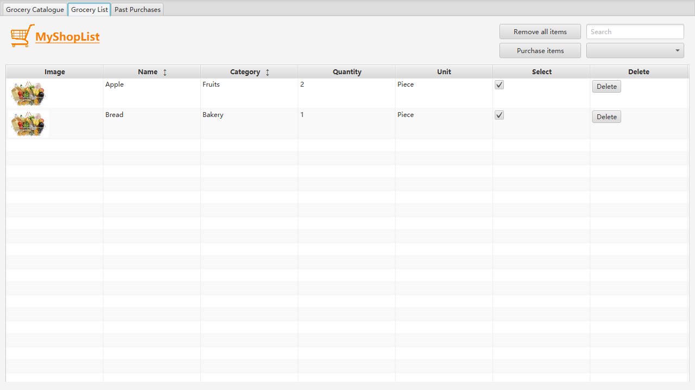
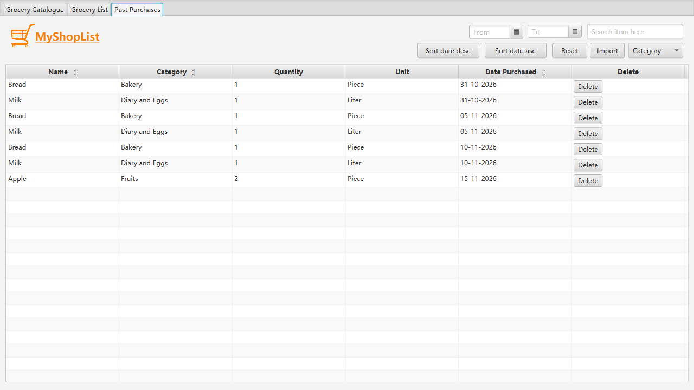
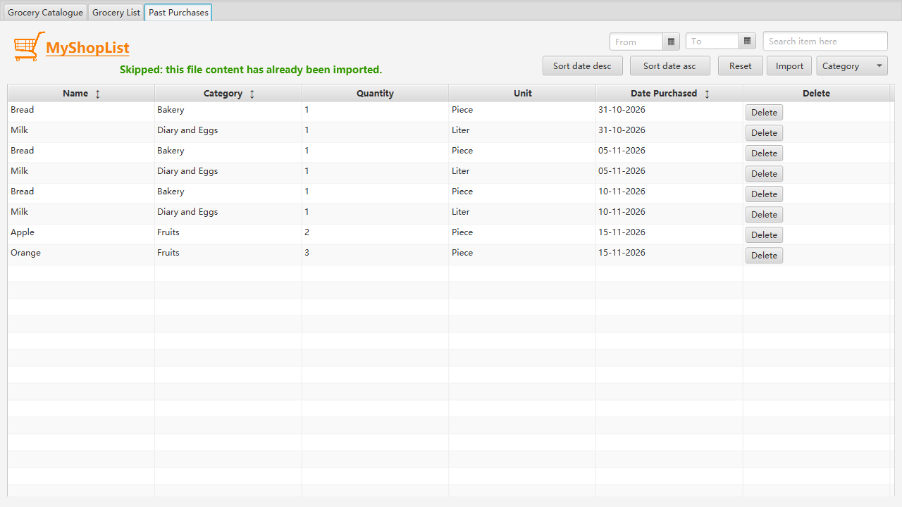
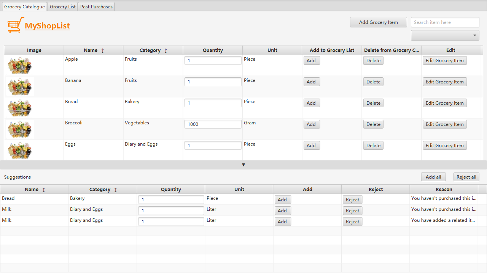

# Running application: screenshots and walkthrough

[37-second MP4, 1280 × 800, no audio](media/smart-grocery-list-demo.mp4?raw=true) · [Animated preview](media/demo-preview.gif) · [Back to README](../README.md)

The application viewport is 1280 × 720. The video adds an 80-pixel caption strip above it. These are actual scene captures of the existing production JavaFX FXML, not mockups or redesigned screens. The session uses Spring services and an isolated real MariaDB database with synthetic catalogue/history data. No application UI source was changed for this capture.

## What to watch

| Time | Action and result |
| --- | --- |
| 00–08 s | Browse and search the catalogue; use its Add buttons to add Apple and Bread. |
| 08–13 s | Open the shopping list, commit Apple quantity 2 and select both rows. |
| 13–20 s | Search for Apple and purchase it. Clear the search: the hidden selected Bread remains in the list. |
| 20–27 s | Open history; combine Apple search with today's inclusive date range, then Reset. |
| 27–33 s | Import CSV, then import identical contents again: a skip message appears and quantity does not increase. |
| 33–37 s | Open the suggestions drawer to inspect replenishment and related-item suggestions. |

The quantity edit and file choice are supplied by the demonstration harness through production edit/import handlers. Table buttons, checkboxes and tab controls are fired programmatically. The video assembles real scene snapshots at 5 frames per second; it is a scripted walkthrough, not a recording of manual mouse/keyboard acceptance. The source application commit was `2829771fc7680d6383264656a98f728a44a97323`.

The capture checks database outcomes: Bread remains, Apple history quantity is 2, and repeated Orange CSV import retains quantity 3. Main application database table counts were unchanged. Capture metadata and asset hashes are in [capture-manifest.json](media/capture-manifest.json).

## Catalogue

Eight synthetic catalogue items demonstrate categories, units, quantities and row actions. The shared grocery image is the existing placeholder asset.



## Shopping list

Apple quantity 2 is persisted; Apple and Bread are selected before the demonstration filters to Apple.



## Purchase history

Bread and Milk have seeded historical purchases; Apple is the new purchase produced during the demonstration.



[View combined name/date filtering](media/purchase-history.png).

## CSV import

The second import of the same file is skipped. Orange remains at quantity 3.



The demonstration uses UTF-8, semicolon-separated input:

```csv
name;date;quantity;unit;category
Orange;2026-11-15;3;Piece;Fruits
```

For a fresh local test, use a current date and a new file. Successful content hashes are stored in `imported_files`, so renaming an identical successfully imported file will still skip it.

## Suggestions

The drawer displays replenishment and related-item reasons. The two Milk rows represent different recommendation types; repeated day-count updates within one type reuse its existing row. Do not interpret these synthetic examples as a measurement of recommendation accuracy.



## Reproduce the workflow locally

Follow [setup](SETUP.md), then use a fresh demonstration database rather than personal grocery data. Create Apple, Bread and Milk; add Apple/Bread to the list, change Apple's quantity to 2, select both, filter to Apple and purchase. Clear the search and verify Bread remains. In history, search Apple, set date bounds to its purchase date and Reset. Import a CSV twice and check the duplicate message. Replenishment examples require repeated historical purchases; one isolated new purchase alone does not establish a purchase cycle.

## Visual and verification limits

The current layout truncates some date-picker strings under the captured Windows locale and ellipsizes long recommendation reasons. The capture log also recorded Windows JavaFX accessibility exceptions, while the scripted workflow and database checks completed. These observations remain to be resolved alongside the [known UI test failures](KNOWN_ISSUES.md); the media does not establish full native interaction or accessibility acceptance.

This visual material was added during the 2026 portfolio review. Team authorship and the owner's original coursework contributions remain documented in [contributions](CONTRIBUTIONS.md).
